<!-- Profile README for @sandip1pandit -->
<picture>
  <source media="(prefers-color-scheme: dark)" srcset="dark.svg">
  <source media="(prefers-color-scheme: light)" srcset="light.svg">
  
</picture>

<h1 align="center">Hi, I'm Sandip Pandit 👋</h1>
<h3 align="center">AI/ML Developer · Generative AI Enthusiast · B.Tech CSE</h3>

  I build Python applications around machine learning, LLMs, and intelligent automation.
  I'm especially interested in turning ideas into practical AI-powered tools.

  
  

---

## 👨‍💻 About Me

- 🎓 B.Tech student in **Computer Science & Engineering** (MAKAUT).
- 🐍 Working primarily with **Python**.
- 🤖 Exploring **Machine Learning, Generative AI, and LLM-powered applications**.
- 🔎 Interested in **RAG, AI agents, vector search, and workflow automation**.
- 🧪 I enjoy learning by building, testing, and improving practical projects.

## 🧰 Tech Stack

  

  
  
  
  
  
  
  

## 🚀 Featured Projects

<table>
  <tr>
    <td width="50%">
      <h3>📚 RAG Student Handbook Assistant</h3>
      
A document-grounded question-answering application that ingests a PDF handbook, creates embeddings, retrieves relevant content, and uses an LLM to generate context-aware answers.

      
<strong>Tech:</strong> Python · RAG · Hugging Face · Redis Vector Store · Docker · LLM APIs

      <a href="https://github.com/sandip1pandit/AI-Powered-RAG-Question-Answering-System">View repository →</a>
    </td>
    <td width="50%">
      <h3>🧠 Multi-Project Generative AI Internship</h3>
      
A collection of internship tasks, including PDF-to-JSON extraction, a RAG question-answering system, a multi-tool autonomous agent, and a Streamlit chatbot.

      
<strong>Tech:</strong> Python · Gemini API · Pydantic · LangChain · RAG · Streamlit · FastAPI

      <a href="https://github.com/sandip1pandit/Datheon_Python_-_Generative_AI_-_LangChain_Internship">View repository →</a>
    </td>
  </tr>
  <tr>
    <td colspan="2">
      <h3>▶️ YouTube Video Analyzer</h3>
      
A Streamlit-based project exploring an AI agent workflow for analyzing YouTube video content.

      
<strong>Tech:</strong> Python · Streamlit · Agno · Groq · YouTube Tools

      <a href="https://github.com/sandip1pandit/yt_analyzer">View repository →</a>
    </td>
  </tr>
</table>

## 📊 GitHub Activity

  
  

  

## 🐍 Contribution Snake

  <picture>
    <source media="(prefers-color-scheme: dark)" srcset="https://raw.githubusercontent.com/sandip1pandit/sandip1pandit/output/github-contribution-grid-snake-dark.svg">
    <source media="(prefers-color-scheme: light)" srcset="https://raw.githubusercontent.com/sandip1pandit/sandip1pandit/output/github-contribution-grid-snake.svg">
    
  </picture>

## 🌱 Currently Exploring

- Building reliable LLM applications with retrieval and tool use.
- Designing agent workflows with LangGraph.
- Improving model development, evaluation, and deployment skills.

## 🤝 Let's Connect

- GitHub: [@sandip1pandit](https://github.com/sandip1pandit)
- Projects: [Browse my repositories](https://github.com/sandip1pandit?tab=repositories)

---

  <i>“Build consistently. Learn continuously. Improve every day.”</i>

  

