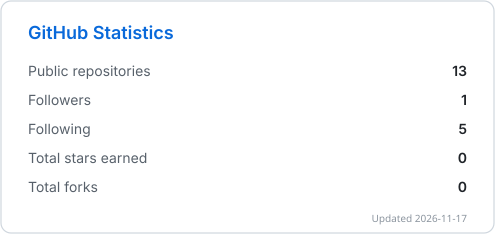
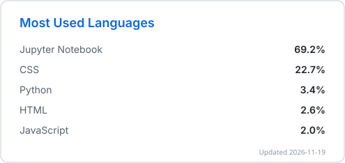

<!-- Profile README for @sandip1pandit -->

<h1 align="center">Hi, I'm Sandip Pandit 👋</h1>
<h3 align="center">AI/ML Learner · Generative AI Developer · Python</h3>

  <picture>
  <source media="(prefers-color-scheme: dark)" srcset="https://raw.githubusercontent.com/sandip1pandit/sandip1pandit/main/profile-dashboard.svg">
  <source media="(prefers-color-scheme: light)" srcset="https://raw.githubusercontent.com/sandip1pandit/sandip1pandit/main/profile-dashboard-light.svg">
  
</picture>

## About Me

I'm a Computer Science and Engineering undergraduate at MAKAUT, interested in building practical solutions with Python, Machine Learning, and Generative AI. I enjoy working across the ML workflow—from data cleaning and EDA to model building and deploying interactive applications.

- 🎓 **B.Tech in Computer Science & Engineering**, MAKAUT (2023–2027)
- 📊 CGPA: **7.42** (up to 6th Semester)
- 🤖 Focus areas: Machine Learning, Deep Learning, NLP, and Generative AI
- 🧰 Building with Python, ML frameworks, LLM tools, and backend technologies

## What I Do

- **Machine Learning:** data cleaning, EDA, text preprocessing, feature extraction, model building, and evaluation
- **Generative AI:** LLM applications, LangChain, LangGraph, and Retrieval-Augmented Generation (RAG)
- **Backend Development:** APIs and applications with Flask, FastAPI, and Streamlit
- **Data & Databases:** SQL, MySQL, Redis, Neo4j, ChromaDB, and SQLAlchemy

## Featured Projects

### 📩 [Email/SMS Spam Classifier](https://github.com/sandip1pandit/spam_classifier)

An ML-based spam classification system with data cleaning, exploratory data analysis, text preprocessing, feature extraction, and model comparison. Compared **10+ classification algorithms**; the Extra Trees Classifier achieved **97.68% accuracy**. Includes an interactive Streamlit interface for real-time spam predictions.

**Tech:** Python · Scikit-learn · NLTK · Streamlit

### 📚 [AI-Powered RAG Question Answering System](https://github.com/sandip1pandit/AI-Powered-RAG-Question-Answering-System)

A document-grounded question-answering system for PDF files. Implements document loading, text chunking, Hugging Face embeddings, and Qdrant vector storage to retrieve relevant content and generate context-grounded answers with page references. The vector database is containerized using Docker.

**Tech:** Python · LangChain · Qdrant · Groq · Hugging Face · Docker

## Technical Skills

| Area | Technologies |
|---|---|
| Programming Languages | Python · C · SQL · JavaScript |
| AI / Machine Learning | Machine Learning · Deep Learning · NLP · Scikit-learn · TensorFlow · PyTorch |
| Generative AI | LangChain · LangGraph · RAG · Hugging Face · ChromaDB |
| Backend & Databases | Flask · FastAPI · MySQL · SQLAlchemy · Redis · Neo4j |
| Tools & Platforms | Git · GitHub · VS Code · Cursor · Jupyter · Docker |
| Additional | Streamlit · OpenCV · Reinforcement Learning · Python Automation |

## Coursework

Operating Systems · OOPS · DBMS · Data Structures & Algorithms · Artificial Intelligence · Web Development · Networking · Machine Learning

## Certifications & Activities
- **Databricks Accredited Generative AI Fundamentals** — Databricks Academy (November 21, 2026)

- Introduction to Machine Learning — **NPTEL**
- One-Day Seminar on Ambient and Assistive Technology — **The Institution of Engineers (India)**
- Internal Institute Level Hackathon 2024 — **DIATM**

  

## GitHub

  
  

  <picture>
    <source media="(prefers-color-scheme: dark)" srcset="https://raw.githubusercontent.com/sandip1pandit/sandip1pandit/output/github-contribution-grid-snake-dark.svg">
    <source media="(prefers-color-scheme: light)" srcset="https://raw.githubusercontent.com/sandip1pandit/sandip1pandit/output/github-contribution-grid-snake.svg">
    
  </picture>

## 📫 Connect With Me

  💼 <a href="https://www.linkedin.com/in/sandip-pandit-6ba6272b7/">LinkedIn</a> 
  📧 <a href="mailto:cs2366.diatm@gmail.com">Email</a>

---

<i>Build with curiosity. Learn by doing. Keep improving.</i>

