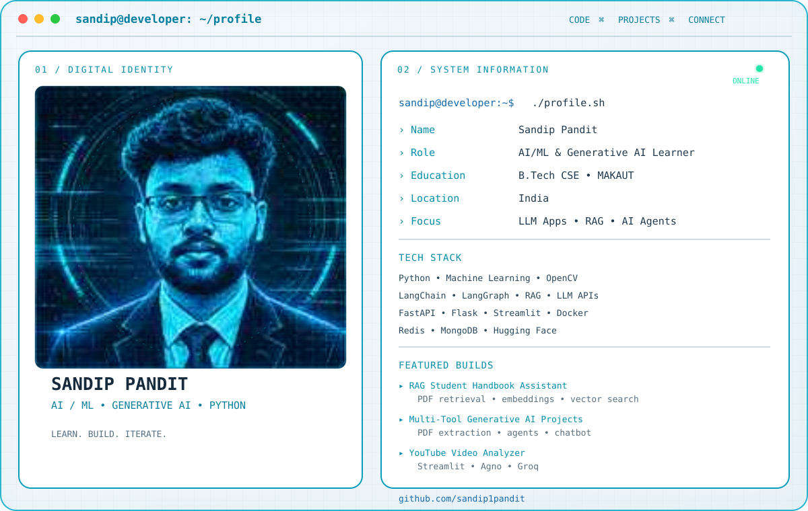

<!-- Profile README for @sandip1pandit -->

<h1 align="center">Hi, I'm Sandip Pandit 👋</h1>
<h3 align="center">AI/ML Learner · Generative AI Developer · Python</h3>

  <picture>
  <source media="(prefers-color-scheme: dark)" srcset="https://raw.githubusercontent.com/sandip1pandit/sandip1pandit/main/profile-dashboard.svg">
  <source media="(prefers-color-scheme: light)" srcset="https://raw.githubusercontent.com/sandip1pandit/sandip1pandit/main/profile-dashboard-light.svg">
  
</picture>

## About Me

I'm a Computer Science and Engineering undergraduate interested in building practical applications with Python, Machine Learning, and Generative AI.

- 🎓 B.Tech in Computer Science & Engineering — MAKAUT (2023–2027)
- 🤖 Exploring LLM-powered applications, Retrieval-Augmented Generation (RAG), and AI agents
- 🧩 Interested in connecting models, tools, APIs, and data to build useful applications
- 🛠️ I learn by building projects, experimenting, and improving them step by step

## What I Do Best

- **Generative AI:** LLM applications, prompt workflows, LangChain, LangGraph
- **RAG systems:** document loading, chunking, embeddings, retrieval, vector search
- **AI agents:** tool use, multi-step workflows, automation
- **Python development:** APIs and interactive apps with FastAPI, Flask, and Streamlit
- **Machine Learning:** data preprocessing, EDA, model building, and evaluation

## Featured Projects

### 📚 [RAG Student Handbook Assistant](https://github.com/sandip1pandit/AI-Powered-RAG-Question-Answering-System)
A document-grounded question-answering project that processes a PDF handbook, creates embeddings, retrieves relevant content, and generates context-aware answers.

**Tech:** Python · RAG · Hugging Face · Redis Vector Store · Docker · LLM APIs

### 🧠 [Generative AI & LangChain Internship Projects](https://github.com/sandip1pandit/Datheon_Python_-_Generative_AI_-_LangChain_Internship)
A collection of practical tasks covering PDF-to-JSON extraction, retrieval-based question answering, a multi-tool autonomous agent, and a chatbot interface.

**Tech:** Python · Gemini API · Pydantic · LangChain · RAG · Streamlit · FastAPI

### ▶️ [YouTube Video Analyzer](https://github.com/sandip1pandit/yt_analyzer)
A Streamlit project exploring an AI-agent workflow for analyzing YouTube video content.

**Tech:** Python · Streamlit · Agno · Groq · YouTube Tools

## Technical Stack

| Area | Technologies |
|---|---|
| Programming | Python |
| AI / ML | Machine Learning, OpenCV, data preprocessing, EDA |
| Generative AI | LLM APIs, LangChain, LangGraph, RAG |
| Vector Search & Data | Redis, MongoDB, vector databases, Hugging Face |
| Backend & Apps | FastAPI, Flask, Streamlit |
| Tools | Git, GitHub, Docker |

  

## GitHub

  
  

  <picture>
    <source media="(prefers-color-scheme: dark)" srcset="https://raw.githubusercontent.com/sandip1pandit/sandip1pandit/output/github-contribution-grid-snake-dark.svg">
    <source media="(prefers-color-scheme: light)" srcset="https://raw.githubusercontent.com/sandip1pandit/sandip1pandit/output/github-contribution-grid-snake.svg">
    
  </picture>

## 📫 Connect With Me

  💼 <a href="https://www.linkedin.com/in/sandip-pandit-6ba6272b7/">LinkedIn</a> 
  📧 <a href="mailto:cs2366.diatm@gmail.com">Email</a>

---

<i>Build with curiosity. Learn by doing. Keep improving.</i>

